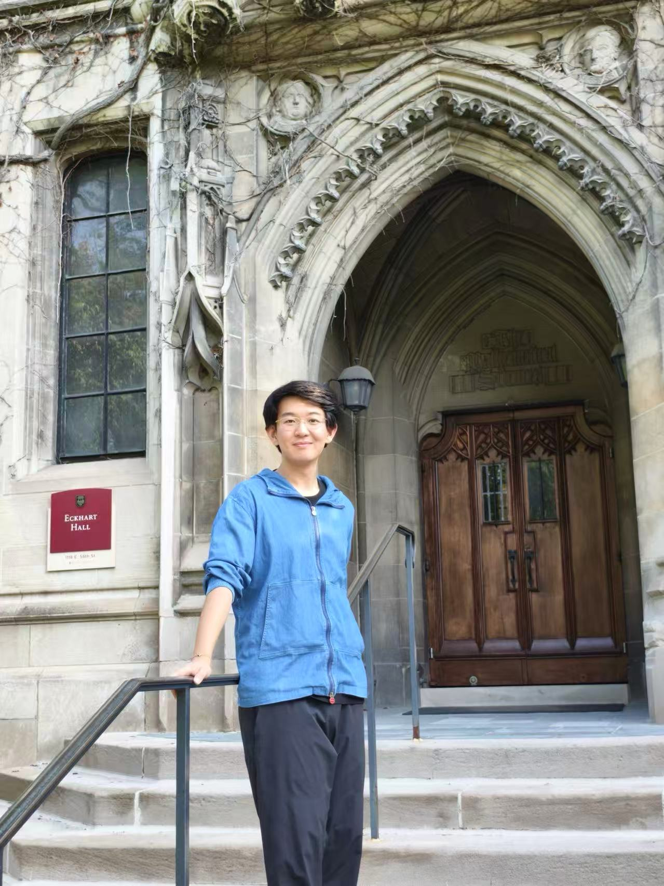

<!--
  Homepage editing notes:
  1. Change the displayed name at "# Yanpu Wu" below.
  2. Change the browser-tab title in "pagetitle" above.
  3. Change the navbar title "Yanpu Wu's Homepage" in _quarto.yml.
  4. The portrait path is images/portrait.jpg.
  5. The CV path is files/cv/Yanpu_Wu_CV.pdf.
  6. Friends & Links is left commented out until you are ready to add real links.
  7. The deep-side prompt is currently non-clickable; it can later be turned into a link.
-->

:::::: {.home-shell}

::::: {.home-portrait-column}

  <a href="files/cv/Yanpu_Wu_CV.pdf" target="_blank">
    Curriculum Vitae
  </a>

  <a href="mailto:confusianwyp0127@gmail.com">
    confusianwyp0127@gmail.com
  </a>

:::::

::::: {.home-intro}

:::: {.eyebrow}
MATHEMATICS · ACADEMIC HOMEPAGE
::::

# Yanpu Wu

:::: {.home-lead}
I am currently a fourth-year undergraduate student at the
[School of Mathematical Sciences](https://math.pku.edu.cn/){target="_blank"},
[Peking University](https://www.pku.edu.cn/){target="_blank"}. And I am planning to apply for PhD programs in mathematics starting in 2027. 

My undergraduate study has been mainly focused on topics in algebraic geometry and mathematics physics, including moduli of Higgs bundles, Hitchin fibration and BCOV rings. 

I am always interested in many different topics, not only limited to my study. For instance, geometric invariant theory and construction of moduli spaces and stacks are one of my main interests currently, closely related to what I have learned. Besides, algebraic K theory and algebraic cycles also attracts me though I have only had little time to learn about it. I hope to discover more in the future years.
::::

:::: {.friends-block}

Friends

<em>Quid faciat laetum me, quo lumine animum vertere,
    hinc canere incipiam:</em>
    
<a href="https://shilewang.github.io/"target="_blank">Shile Wang</a>  , &nbsp;
<a href="https://tempcontainer.github.io/" target="_blank">Zhenyi Wang</a> , &nbsp;
<a href="https://leopoldwuhanzhou.github.io/" target="_blank">Wuhan Zhou</a>

::::

:::::

↘

Click to see my deeper side
(currently unavailable)

::::::
